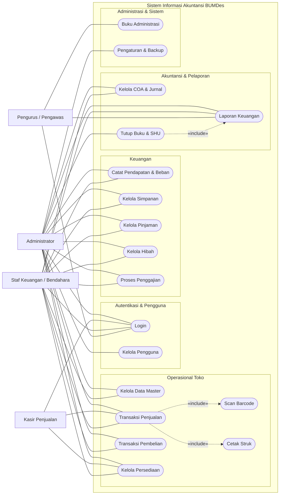
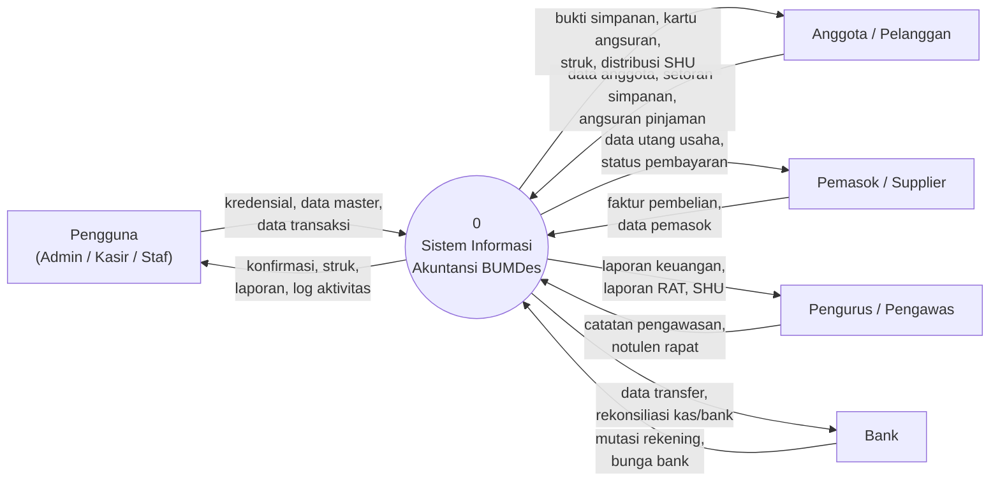
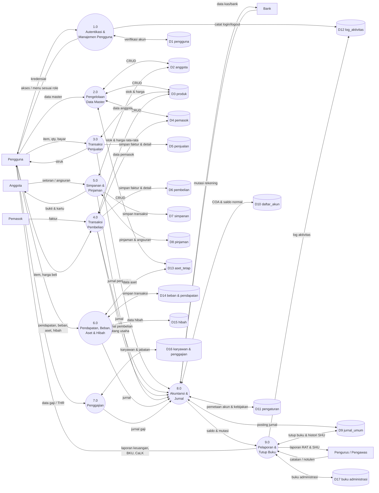
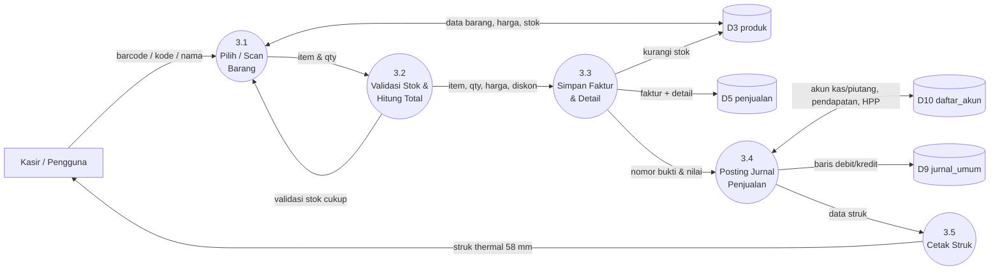
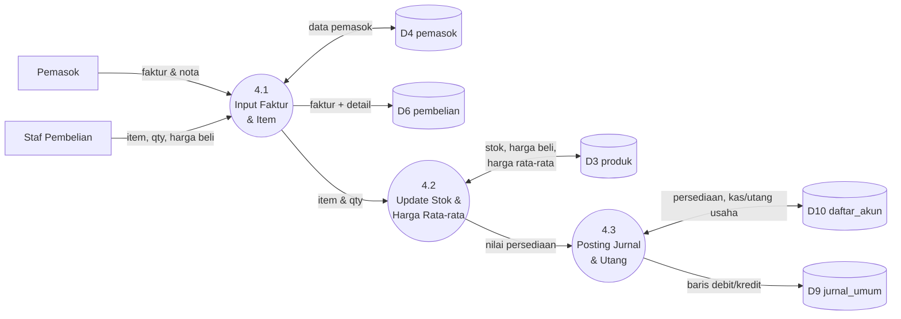
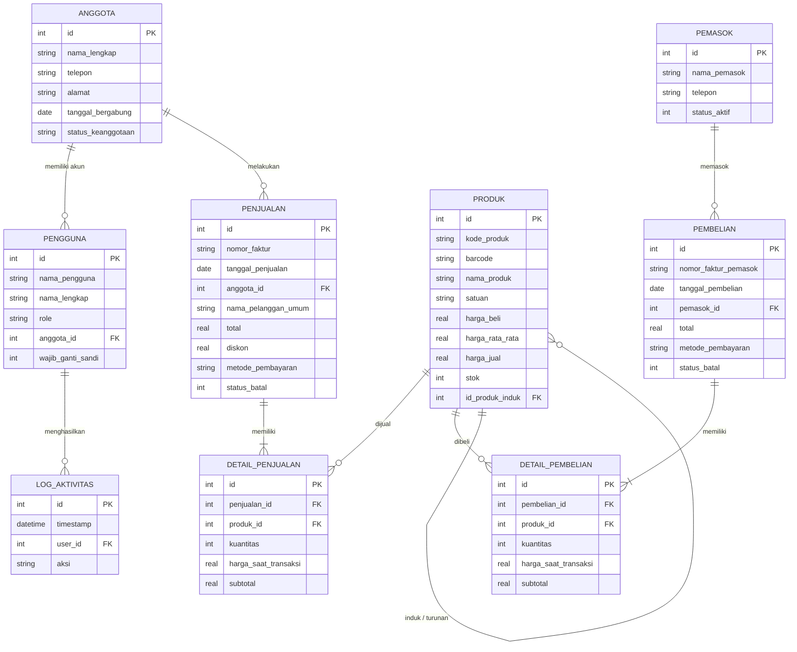
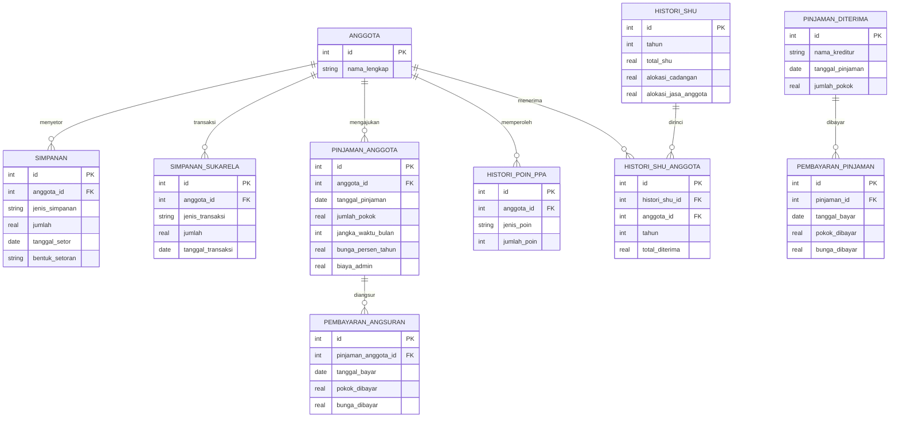
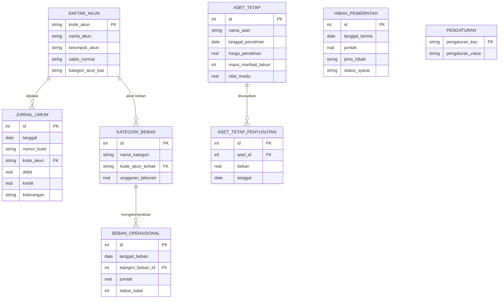
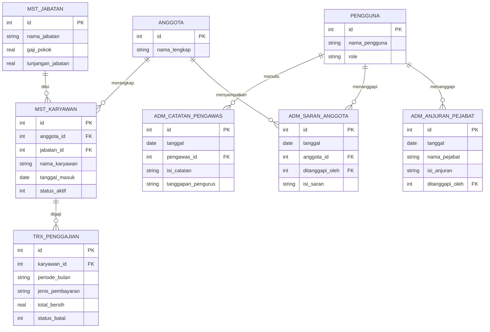

# Sistem Akuntansi Koperasi / BUMDes

Aplikasi akuntansi dan administrasi untuk koperasi maupun BUMDes, dibangun dengan PHP dan SQLite. Bisa dipasang sebagai aplikasi web di hosting maupun dijalankan sebagai aplikasi desktop offline lewat Electron.

## Fitur

| Modul | Cakupan |
|---|---|
| Kas & Bank | Buku kas umum, arus kas, transaksi tunai/bank |
| Penjualan | Faktur, pelanggan umum & anggota, penjualan kredit, retur, cetak struk |
| Pembelian | Faktur pemasok, pembelian kredit, pembayaran utang, retur |
| Persediaan | Produk, barcode, konversi satuan, stok minimum, barang terlaris |
| Keanggotaan | Anggota/penyerta modal, simpanan pokok & wajib, simpanan sukarela |
| Pinjaman | Pinjaman anggota & angsuran, pinjaman diterima, skor kredit |
| Aset Tetap | Perolehan, penyusutan bulanan, pelepasan aset |
| Beban & Pendapatan | Kategori beban, anggaran, pendapatan lain |
| Hibah | Hibah pemerintah, syarat pencairan, pengakuan |
| Akuntansi | Bagan akun (COA), jurnal umum, jurnal penyesuaian, tutup buku |
| Laporan | Posisi keuangan, perubahan ekuitas, SHU, arus kas, buku kas, umur piutang/utang, CALK, ekspor audit |
| Administrasi | Surat masuk/keluar, buku tamu, rapat, catatan pengawas, saran anggota |
| SDM | Jabatan, karyawan, penggajian |
| Pengguna | Multi-role/RBAC, log aktivitas, kebijakan kata sandi |

Dua mode entitas tersedia: **Koperasi** dan **BUMDes** (istilah serta pemetaan akun mengikuti Kepmendesa PDTT 136/2022 dan SAK EP).

## Teknologi

- PHP 8.2+ dengan PDO SQLite, tanpa framework
- SQLite sebagai basis data tunggal
- Tailwind CSS + DaisyUI (CDN), Alpine.js, Tom Select
- Composer: PHPMailer, Parsedown
- Electron 28 + electron-builder untuk mode desktop
- Routing terpusat (`publik/index.php`, `proses.php`, `ajax.php`) dengan rewrite `.htaccess`

## Struktur

```
.
├── publik/                  # document root web
│   ├── index.php            # router halaman
│   ├── proses.php           # router aksi POST
│   ├── ajax.php             # router endpoint AJAX
│   ├── router.php           # router PHP built-in server
│   ├── aset/                # CSS/JS/gambar
│   └── unggahan/            # unggahan pengguna (tidak di-commit)
├── sistem/
│   ├── inti/                # bootstrap, koneksi, migrasi skema
│   ├── konfigurasi/         # lokasi database
│   ├── fungsi/              # helper database & autentikasi/RBAC
│   ├── proses/              # handler aksi per modul
│   ├── ajax/                # endpoint AJAX
│   ├── tampilan/            # view per modul + komponen layout
│   └── database/            # koperasi.sqlite (tidak di-commit)
├── panduan/                 # dokumentasi pengguna (Markdown)
├── vendor/                  # dependensi Composer
└── main.js                  # entry Electron
```

## Instalasi Web

1. Salin isi repositori ke direktori aplikasi pada web server.
2. Arahkan document root ke `publik/`, atau gunakan `.htaccess` yang disertakan.
3. Aktifkan ekstensi `pdo_sqlite` dan pastikan `sistem/database/` dapat ditulis.
4. Jalankan `composer install` bila `vendor/` belum tersedia.
5. Buka aplikasi di browser. Skema database dibuat otomatis pada akses pertama.

## Mode Desktop

```bash
npm install
npm start          # Electron + PHP built-in server
npm run build:win  # installer Windows (NSIS)
```

Database desktop disimpan di direktori `userData` Electron, dengan backup otomatis saat aplikasi ditutup.

## Keamanan

- Akun administrator awal dibuat otomatis saat instalasi. Ganti kata sandinya sebelum digunakan.
- Direktori `sistem/database/` dan file `.sqlite` tidak disertakan dalam repositori.
- Laporkan masalah keamanan secara privat, bukan lewat issue publik.

## Dokumentasi

- **Panduan pengguna** — [`panduan/`](panduan/_sidebar.md); juga dapat dibuka dari menu **Panduan** di aplikasi.
- **Desain sistem** — [Use Case, DFD, dan ERD](#use-case-diagram-dfd-dan-erd), ditulis dengan Mermaid dan dapat dirender langsung di GitHub.

---

## Use Case Diagram, DFD, dan ERD
### Sistem Informasi Akuntansi BUMDes / Koperasi (Offline, Single Device)

Dokumen ini disusun berdasarkan kode dan skema database aplikasi ini (SQLite, 39 tabel).
Diagram ditulis dengan **Mermaid** sehingga bisa langsung dirender di:

- <https://mermaid.live> (paste blok kode, lalu Export PNG/SVG)
- VS Code (ekstensi *Markdown Preview Mermaid Support*)
- GitHub / GitLab (blok ```` ```mermaid ```` otomatis dirender)
- draw.io: **Arrange > Insert > Advanced > Mermaid**

---

## 1. USE CASE DIAGRAM

### 1.1 Aktor

| Aktor | Deskripsi | Role di sistem |
|---|---|---|
| Administrator | Pemilik/kepala unit. Akses penuh, termasuk manajemen pengguna, pengaturan, dan backup. | `admin` |
| Kasir Penjualan | Melayani penjualan barang toko, scan barcode, cetak struk, cek stok. | `transaksi_penjualan` |
| Staf Keuangan / Bendahara | Mencatat simpanan, pinjaman, pendapatan, beban, hibah, penggajian, jurnal, dan laporan. | `kelola_*`, `transaksi_beban`, `lihat_laporan`, dll. |
| Pengurus / Pengawas | Memantau laporan keuangan dan mengisi buku administrasi/pengawasan. | `pengurus`, `pengawas` |

> Catatan: aplikasi berjalan offline pada satu perangkat. Satu perangkat bisa dipakai
> bergantian oleh beberapa akun; hak akses ditentukan oleh role akun (single-role).

### 1.2 Diagram

Diagram disederhanakan ke 16 use case utama agar terbaca. Rincian fitur tiap use case
ada pada tabel 1.3.



### 1.3 Definisi Use Case

| Kode | Use Case | Aktor | Rincian |
|---|---|---|---|
| UC01 | Login | Semua | Autentikasi username + password, rate-limit 15 percobaan/15 menit, paksa ganti sandi default, logout. |
| UC02 | Kelola Pengguna | Administrator | CRUD akun, atur role, reset sandi, cegah penghapusan admin terakhir. |
| UC03 | Kelola Data Master | Admin, Staf | Anggota/pelanggan, produk + barcode, pemasok, aset tetap, jabatan & karyawan. |
| UC04 | Transaksi Penjualan | Admin, Kasir, Staf | Keranjang, diskon, tunai/transfer/kredit, potong stok, jurnal otomatis; include scan barcode dan cetak struk. |
| UC05 | Transaksi Pembelian | Admin, Staf | Faktur pemasok, update stok & harga rata-rata, utang usaha, jurnal otomatis. |
| UC06 | Kelola Persediaan | Admin, Staf, Kasir (lihat) | Stok opname, pecah barang, penurunan nilai, kartu stok, stok minimum. |
| UC07 | Catat Pendapatan & Beban | Admin, Staf | Pendapatan lain-lain, beban operasional per kategori, jurnal otomatis. |
| UC08 | Kelola Simpanan | Admin, Staf | Simpanan pokok/wajib/sukarela, setoran tunai/bank, jurnal otomatis. |
| UC09 | Kelola Pinjaman | Admin, Staf | Pinjaman anggota (pencairan, biaya admin, angsuran pokok + bunga) dan pinjaman diterima (utang bank). |
| UC10 | Kelola Hibah | Admin, Staf | Hibah pemerintah/donasi, status syarat, pengakuan pendapatan. |
| UC11 | Proses Penggajian | Admin, Staf | Master jabatan, karyawan, gaji & THR, jurnal beban gaji. |
| UC12 | Kelola COA & Jurnal | Admin, Staf | Bagan akun, pemetaan akun otomatis, jurnal umum, penyesuaian, pajak. |
| UC13 | Laporan Keuangan | Admin, Staf, Pengurus | Laba rugi, neraca, perubahan ekuitas, arus kas, BKU, CaLK, kesehatan; cetak/ekspor. |
| UC14 | Tutup Buku & SHU | Administrator | Hitung laba tahun berjalan, kunci periode, distribusi SHU per anggota. |
| UC15 | Buku Administrasi | Staf, Pengurus | Surat masuk/keluar, buku tamu, kejadian penting, rapat, saran, catatan pengawas, log aktivitas. |
| UC16 | Pengaturan & Backup | Administrator | Identitas entitas, kebijakan SHU, kategori beban, migrasi saldo awal, backup/restore. |

> Rincian teknis: hak akses memakai satu kolom `role`. Role `admin` dapat membuka semua
> menu; role lain hanya menu yang sesuai. Menu **Manajemen Pengguna** hanya tampil untuk
> `admin`.

---

## 2. DATA FLOW DIAGRAM (DFD)

### 2.1 DFD Level 0 (Context Diagram)



### 2.2 DFD Level 1



#### Keterangan Proses DFD Level 1

| Proses | Nama | Input | Output | Data store |
|---|---|---|---|---|
| 1.0 | Autentikasi & Manajemen Pengguna | kredensial, data akun | sesi login, menu sesuai role | D1, D12 |
| 2.0 | Pengelolaan Data Master | data anggota, produk, pemasok, aset | master data valid | D2, D3, D4, D13 |
| 3.0 | Transaksi Penjualan | item, qty, metode bayar | faktur penjualan, struk, jurnal | D3, D5, D9 |
| 4.0 | Transaksi Pembelian | faktur pemasok, item, harga beli | faktur pembelian, stok bertambah, utang, jurnal | D3, D4, D6, D9 |
| 5.0 | Simpanan & Pinjaman | setoran, pencairan, angsuran | kartu simpanan/pinjaman, jurnal | D2, D7, D8, D9 |
| 6.0 | Pendapatan, Beban, Aset & Hibah | transaksi operasional | jurnal pendapatan/beban, kartu aset, hibah | D13, D14, D15, D9 |
| 7.0 | Penggajian | data karyawan, gaji, THR | slip/gaji, jurnal beban gaji | D16, D9 |
| 8.0 | Akuntansi & Jurnal | semua transaksi, COA, pemetaan | jurnal umum, saldo akun | D9, D10, D11 |
| 9.0 | Pelaporan & Tutup Buku | saldo, mutasi, periode | laporan keuangan, SHU, buku administrasi | D9, D12, D17 |

#### Kamus Data Ringkas (Data Store)

| Store | Isi | Tabel asal |
|---|---|---|
| D1 pengguna | akun, hash sandi, role, status wajib ganti sandi | `pengguna` |
| D2 anggota | identitas anggota/pelanggan, status keaktifan | `anggota` |
| D3 produk | barang dagang & perlengkapan, barcode, stok, harga | `produk` |
| D4 pemasok | identitas supplier | `pemasok` |
| D5 penjualan | faktur penjualan + detail item | `penjualan`, `detail_penjualan` |
| D6 pembelian | faktur pembelian + detail item | `pembelian`, `detail_pembelian` |
| D7 simpanan | simpanan pokok/wajib & sukarela | `simpanan`, `simpanan_sukarela_transaksi` |
| D8 pinjaman | pinjaman anggota, angsuran, pinjaman diterima | `pinjaman_anggota`, `pembayaran_angsuran`, `pinjaman_diterima`, `pembayaran_pinjaman` |
| D9 jurnal_umum | seluruh baris debit/kredit, nomor bukti | `jurnal_umum`, `histori_shu*` |
| D10 daftar_akun | COA, kelompok, saldo normal, kategori arus kas | `daftar_akun` |
| D11 pengaturan | identitas entitas, pemetaan akun, kebijakan SHU | `pengaturan` |
| D12 log_aktivitas | jejak aksi pengguna | `log_aktivitas` |
| D13 aset_tetap | aset, penyusutan | `aset_tetap`, `aset_tetap_penyusutan` |
| D14 beban & pendapatan | beban operasional, kategori beban | `beban_operasional`, `kategori_beban` |
| D15 hibah | hibah pemerintah/donasi | `hibah_pemerintah` |
| D16 karyawan | jabatan, karyawan, penggajian | `mst_jabatan`, `mst_karyawan`, `trx_penggajian` |
| D17 buku administrasi | surat, tamu, rapat, saran, pengawasan | 11 tabel `adm_*` |

### 2.3 DFD Level 2 - Proses 3.0 Transaksi Penjualan



### 2.4 DFD Level 2 - Proses 4.0 Transaksi Pembelian



---

## 3. ENTITY RELATIONSHIP DIAGRAM (ERD)

### 3.1 ERD Gabungan (referensi)

Diagram ini memuat seluruh entitas sekaligus. Lebar render ±10.000 px, jadi **jangan
ditempel langsung ke halaman A4**; gunakan diagram per-modul di 3.2–3.5 untuk laporan,
dan simpan versi ini sebagai lampiran A3 atau referensi digital.

Relasi utama diturunkan dari kolom foreign key yang dipakai aplikasi (SQLite tidak
mendeklarasikan constraint FK, jadi relasi bersifat logis di level aplikasi).

```mermaid
erDiagram
    PENGGUNA ||--o{ LOG_AKTIVITAS : "menghasilkan"
    PENGGUNA ||--o{ ADM_CATATAN_PENGAWAS : "menanggapi"
    PENGGUNA ||--o{ ADM_SARAN_ANGGOTA : "menanggapi"
    PENGGUNA ||--o{ ADM_ANJURAN_PEJABAT : "menanggapi"
    ANGGOTA  ||--o{ PENGGUNA : "akun anggota"
    ANGGOTA  ||--o{ PENJUALAN : "melakukan"
    ANGGOTA  ||--o{ SIMPANAN : "menyetor"
    ANGGOTA  ||--o{ SIMPANAN_SUKARELA : "transaksi"
    ANGGOTA  ||--o{ PINJAMAN_ANGGOTA : "mengajukan"
    ANGGOTA  ||--o{ HISTORI_POIN_PPA : "memperoleh poin"
    ANGGOTA  ||--o{ HISTORI_SHU_ANGGOTA : "menerima SHU"
    ANGGOTA  ||--o{ MST_KARYAWAN : "merangkap karyawan"
    ANGGOTA  ||--o{ ADM_SARAN_ANGGOTA : "menyampaikan"

    PENJUALAN ||--|{ DETAIL_PENJUALAN : "memiliki"
    PRODUK    ||--o{ DETAIL_PENJUALAN : "dijual pada"
    PEMBELIAN ||--|{ DETAIL_PEMBELIAN : "memiliki"
    PRODUK    ||--o{ DETAIL_PEMBELIAN : "dibeli pada"
    PEMASOK   ||--o{ PEMBELIAN : "memasok"
    PRODUK    ||--o{ PRODUK : "barang induk"

    PINJAMAN_ANGGOTA ||--o{ PEMBAYARAN_ANGSURAN : "diangsur"
    PINJAMAN_DITERIMA ||--o{ PEMBAYARAN_PINJAMAN : "dibayar"

    DAFTAR_AKUN ||--o{ JURNAL_UMUM : "dipakai"
    DAFTAR_AKUN ||--o{ KATEGORI_BEBAN : "akun beban"
    KATEGORI_BEBAN ||--o{ BEBAN_OPERASIONAL : "mengelompokkan"

    ASET_TETAP ||--o{ ASET_TETAP_PENYUSUTAN : "disusutkan"

    HISTORI_SHU ||--o{ HISTORI_SHU_ANGGOTA : "dirinci"

    MST_JABATAN ||--o{ MST_KARYAWAN : "diisi"
    MST_KARYAWAN ||--o{ TRX_PENGGAJIAN : "digaji"

    PENGGUNA {
        int id PK
        string nama_pengguna
        string nama_lengkap
        string kata_sandi
        string role
        int anggota_id FK
        int wajib_ganti_sandi
    }

    ANGGOTA {
        int id PK
        string nama_lengkap
        string alamat
        string telepon
        date tanggal_bergabung
        string status_keanggotaan
        string jenis_entitas
    }

    PRODUK {
        int id PK
        string kode_produk
        string barcode
        string nama_produk
        string satuan
        real harga_beli
        real harga_rata_rata
        real harga_jual
        int stok
        int stok_minimum
        int id_produk_induk FK
        int kuantitas_konversi
        string jenis_barang
    }

    PEMASOK {
        int id PK
        string nama_pemasok
        string alamat
        string telepon
        int status_aktif
    }

    PENJUALAN {
        int id PK
        string nomor_faktur
        date tanggal_penjualan
        int anggota_id FK
        string nama_pelanggan_umum
        real total
        real diskon
        string metode_pembayaran
        int status_batal
    }

    DETAIL_PENJUALAN {
        int id PK
        int penjualan_id FK
        int produk_id FK
        int kuantitas
        real harga_saat_transaksi
        real subtotal
    }

    PEMBELIAN {
        int id PK
        string nomor_faktur_pemasok
        date tanggal_pembelian
        int pemasok_id FK
        real total
        string metode_pembayaran
        int status_batal
    }

    DETAIL_PEMBELIAN {
        int id PK
        int pembelian_id FK
        int produk_id FK
        int kuantitas
        real harga_saat_transaksi
        real subtotal
    }

    SIMPANAN {
        int id PK
        int anggota_id FK
        string jenis_simpanan
        real jumlah
        date tanggal_setor
        string bentuk_setoran
    }

    SIMPANAN_SUKARELA {
        int id PK
        int anggota_id FK
        string jenis_transaksi
        real jumlah
        date tanggal_transaksi
    }

    PINJAMAN_ANGGOTA {
        int id PK
        int anggota_id FK
        date tanggal_pinjaman
        real jumlah_pokok
        int jangka_waktu_bulan
        real bunga_persen_tahun
        real biaya_admin
    }

    PEMBAYARAN_ANGSURAN {
        int id PK
        int pinjaman_anggota_id FK
        date tanggal_bayar
        real pokok_dibayar
        real bunga_dibayar
    }

    PINJAMAN_DITERIMA {
        int id PK
        string nama_kreditur
        date tanggal_pinjaman
        real jumlah_pokok
    }

    PEMBAYARAN_PINJAMAN {
        int id PK
        int pinjaman_id FK
        date tanggal_bayar
        real pokok_dibayar
        real bunga_dibayar
    }

    JURNAL_UMUM {
        int id PK
        date tanggal
        string nomor_bukti
        string kode_akun FK
        string keterangan
        real debit
        real kredit
    }

    DAFTAR_AKUN {
        string kode_akun PK
        string nama_akun
        string kelompok_akun
        string saldo_normal
        string kategori_arus_kas
    }

    KATEGORI_BEBAN {
        int id PK
        string nama_kategori
        string kode_akun_terkait FK
        real anggaran_tahunan
    }

    BEBAN_OPERASIONAL {
        int id PK
        date tanggal_beban
        int kategori_beban_id FK
        real jumlah
        int status_batal
    }

    ASET_TETAP {
        int id PK
        string nama_aset
        string kategori_aset
        date tanggal_perolehan
        real harga_perolehan
        int masa_manfaat_tahun
        real nilai_residu
    }

    ASET_TETAP_PENYUSUTAN {
        int id PK
        int aset_id FK
        real beban
        date tanggal
        string nomor_bukti
    }

    HIBAH_PEMERINTAH {
        int id PK
        date tanggal_terima
        string keterangan
        real jumlah
        string jenis_hibah
        string status_syarat
    }

    HISTORI_SHU {
        int id PK
        int tahun
        real total_shu
        real alokasi_cadangan
        real alokasi_jasa_anggota
        date tanggal_proses
    }

    HISTORI_SHU_ANGGOTA {
        int id PK
        int histori_shu_id FK
        int anggota_id FK
        int tahun
        real total_diterima
    }

    HISTORI_POIN_PPA {
        int id PK
        int anggota_id FK
        string jenis_poin
        int jumlah_poin
        date tanggal_perolehan
    }

    MST_JABATAN {
        int id PK
        string nama_jabatan
        real gaji_pokok
        real tunjangan_jabatan
    }

    MST_KARYAWAN {
        int id PK
        int anggota_id FK
        int jabatan_id FK
        string nama_karyawan
        date tanggal_masuk
        int status_aktif
    }

    TRX_PENGGAJIAN {
        int id PK
        int karyawan_id FK
        string periode_bulan
        string jenis_pembayaran
        real total_bersih
        string nomor_bukti
    }

    PENGATURAN {
        string pengaturan_key PK
        string pengaturan_value
    }

    LOG_AKTIVITAS {
        int id PK
        datetime timestamp
        int user_id FK
        string nama_pengguna
        string aksi
        string ip_address
    }

    ADM_SURAT_MASUK {
        int id PK
        date tanggal_masuk
        string nomor_surat
        string perihal
        string asal_surat
    }

    ADM_SURAT_KELUAR {
        int id PK
        string nomor_surat
        date tanggal_surat
        string tujuan_surat
    }

    ADM_BUKU_TAMU {
        int id PK
        date tanggal
        string nama_tamu
        string keperluan
    }

    ADM_KEJADIAN_PENTING {
        int id PK
        date tanggal
        string jenis_kegiatan
        string uraian
    }

    ADM_RAPAT_ANGGOTA {
        int id PK
        date tanggal_rapat
        string jenis_rapat
        int jumlah_hadir
        string keputusan_rapat
    }

    ADM_RAPAT_PENGURUS {
        int id PK
        date tanggal_rapat
        int jumlah_hadir
        string keputusan_rapat
    }

    ADM_RAPAT_PENGAWAS {
        int id PK
        date tanggal_rapat
        int jumlah_hadir
        string keputusan_rapat
    }

    ADM_CATATAN_PENGAWAS {
        int id PK
        date tanggal
        int pengawas_id FK
        string isi_catatan
        string tanggapan_pengurus
    }

    ADM_SARAN_ANGGOTA {
        int id PK
        date tanggal
        int anggota_id FK
        string isi_saran
        string tanggapan_pengurus
    }

    ADM_ANJURAN_PEJABAT {
        int id PK
        date tanggal
        string nama_pejabat
        string isi_anjuran
        string tanggapan_pengurus
    }
```



### 3.2 ERD Modul Inti: Master & Transaksi

Cakupan: akun pengguna, anggota, barang, pemasok, penjualan, pembelian, dan log aktivitas.



### 3.3 ERD Modul Simpanan, Pinjaman & SHU



### 3.4 ERD Modul Akuntansi, Beban, Aset & Hibah



Catatan: `jurnal_umum` juga menampung jurnal dari modul penjualan, pembelian, simpanan,
pinjaman, penggajian, dan penyusutan; relasi ke jurnal tidak digambar ulang di tiap modul
agar diagram tetap terbaca. `hibah_pemerintah` memposting jurnal melalui `nomor_bukti`.

### 3.5 ERD Modul SDM & Administrasi



Tabel buku administrasi yang **tidak memiliki foreign key** (berdiri sendiri, tidak
digambar agar tidak melebar): `adm_surat_masuk`, `adm_surat_keluar`, `adm_buku_tamu`,
`adm_kejadian_penting`, `adm_rapat_anggota`, `adm_rapat_pengurus`, `adm_rapat_pengawas`.
Semuanya hanya menyimpan data kegiatan dan tanggal, tanpa relasi ke tabel lain.

### 3.6 Tabel Relasi Antar Entitas

| Tabel induk | Tabel anak | Kolom penghubung | Kardinalitas | Keterangan |
|---|---|---|---|---|
| `anggota` | `penjualan` | `penjualan.anggota_id` | 1 : N | Penjualan member; penjualan umum memakai `nama_pelanggan_umum`. |
| `anggota` | `simpanan` | `simpanan.anggota_id` | 1 : N | Simpanan pokok/wajib. |
| `anggota` | `simpanan_sukarela_transaksi` | `anggota_id` | 1 : N | Mutasi simpanan sukarela. |
| `anggota` | `pinjaman_anggota` | `pinjaman_anggota.anggota_id` | 1 : N | Pinjaman per anggota. |
| `anggota` | `histori_poin_ppa` | `anggota_id` | 1 : N | Poin jasa modal/usaha. |
| `anggota` | `histori_shu_anggota` | `anggota_id` | 1 : N | Bagian SHU per anggota per tahun. |
| `anggota` | `mst_karyawan` | `mst_karyawan.anggota_id` | 1 : N | Anggota yang merangkap karyawan. |
| `anggota` | `pengguna` | `pengguna.anggota_id` | 1 : N | Akun login milik anggota (opsional). |
| `penjualan` | `detail_penjualan` | `detail_penjualan.penjualan_id` | 1 : N | Rincian item; hapus/retur memakai `status_batal`. |
| `produk` | `detail_penjualan` | `produk_id` | 1 : N | Barang yang dijual. |
| `pemasok` | `pembelian` | `pembelian.pemasok_id` | 1 : N | Faktur dari pemasok. |
| `pembelian` | `detail_pembelian` | `pembelian_id` | 1 : N | Rincian item pembelian. |
| `produk` | `detail_pembelian` | `produk_id` | 1 : N | Barang yang dibeli. |
| `produk` | `produk` | `produk.id_produk_induk` | 1 : N | Relasi induk–turunan (konversi satuan). |
| `pinjaman_anggota` | `pembayaran_angsuran` | `pinjaman_anggota_id` | 1 : N | Angsuran pokok + bunga. |
| `pinjaman_diterima` | `pembayaran_pinjaman` | `pinjaman_id` | 1 : N | Pembayaran utang bank/pihak ketiga. |
| `daftar_akun` | `jurnal_umum` | `jurnal_umum.kode_akun` | 1 : N | Setiap baris jurnal memakai satu akun. |
| `daftar_akun` | `kategori_beban` | `kode_akun_terkait` | 1 : N | Akun beban default per kategori. |
| `kategori_beban` | `beban_operasional` | `kategori_beban_id` | 1 : N | Pengelompokan beban. |
| `aset_tetap` | `aset_tetap_penyusutan` | `aset_id` | 1 : N | Riwayat penyusutan aset. |
| `histori_shu` | `histori_shu_anggota` | `histori_shu_id` | 1 : N | Distribusi SHU per tahun. |
| `mst_jabatan` | `mst_karyawan` | `jabatan_id` | 1 : N | Jabatan karyawan. |
| `mst_karyawan` | `trx_penggajian` | `karyawan_id` | 1 : N | Riwayat gaji/THR. |
| `pengguna` | `log_aktivitas` | `user_id` | 1 : N | Jejak aksi pengguna. |
| `pengguna` | `adm_catatan_pengawas` | `pengawas_id` | 1 : N | Catatan oleh pengawas. |
| `pengguna` | `adm_saran_anggota` | `ditanggapi_oleh` | 1 : N | Tanggapan pengurus. |
| `pengguna` | `adm_anjuran_pejabat` | `ditanggapi_oleh` | 1 : N | Tanggapan pengurus. |

### 3.7 Catatan Pemodelan

1. **Transaksi berpasangan dengan jurnal.** Hampir semua transaksi (penjualan, pembelian,
   simpanan, pinjaman, beban, hibah, penggajian, penyusutan) menghasilkan baris di
   `jurnal_umum` dengan `nomor_bukti` yang sama. Karena itu laporan keuangan dihitung dari
   `jurnal_umum`, bukan langsung dari tabel transaksi.
2. **Soft delete.** `penjualan`, `pembelian`, `beban_operasional`, dan `trx_penggajian`
   memakai `status_batal`, bukan `DELETE`, agar jejak audit tetap utuh.
3. **Tidak ada tabel pendapatan.** Pendapatan dicatat langsung sebagai jurnal (akun
   kelompok Pendapatan) melalui menu Pendapatan; karenanya ERD tidak memuat entitas
   `pendapatan`.
4. **Pengaturan berbentuk key-value** (`pengaturan_key`, `pengaturan_value`) untuk
   identitas entitas, pemetaan akun otomatis, mode Koperasi/BUMDes, dan kebijakan SHU.
5. **Pemisahan role dan jabatan.** `pengguna.role` dipakai untuk hak akses sekaligus
   penanda jabatan (`pengurus`, `pengawas`) pada laporan kelembagaan.
6. **Barcode** ada di `produk.barcode` (ditambahkan untuk fitur scan kasir/pembelian),
   terpisah dari `kode_produk`.

---

## 4. Cara Export untuk Laporan

1. Buka <https://mermaid.live>.
2. Paste satu blok `mermaid` (tanpa pagar ```).
3. Klik **Actions > Export PNG/SVG**.
4. Untuk dokumen Word: simpan SVG, lalu *Insert > Pictures* (Word 2019+ mendukung SVG),
   atau gunakan PNG resolusi tinggi.
